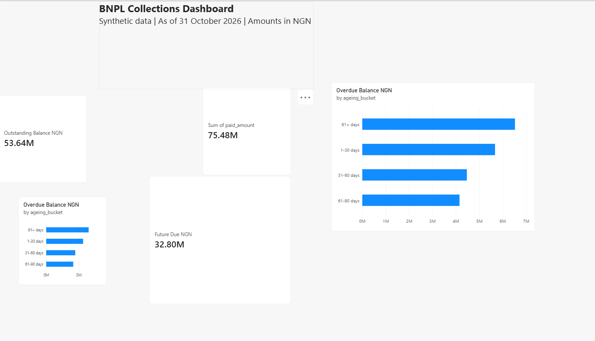

# NGN BNPL Collections — Local Setup

This extension uses synthetic Nigerian naira data, DuckDB, dbt,
and Power BI to demonstrate installment collections reporting.

## Requirements

- Python 3.10
- Git
- Power BI Desktop for viewing the dashboard

Run all PowerShell commands from the repository root.

## Install

```powershell
python -m venv .venv
.\.venv\Scripts\python.exe -m pip install -r requirements-local.txt
```

## Generate and load synthetic data

```powershell
.\.venv\Scripts\python.exe scripts/generate_ngn_data.py
.\.venv\Scripts\python.exe scripts/load_ngn_bronze.py
```

The sample contains 100 customers, 10 merchants, 500 transactions,
500 payment plans, 2,000 installments, and 500 user events.
The reporting date is fixed at 31 October 2026.

The loader replaces the six Bronze tables in the local database.

## Build the collections models

Set the database path in each new PowerShell session:

```powershell
$env:BNPL_DUCKDB_PATH = Join-Path (Get-Location).Path "data\bnpl_ngn.duckdb"
```

Install dbt packages and build the collections model with its ancestors:

```powershell
.\.venv\Scripts\dbt.exe deps --project-dir dbt_project/tabby_dbt --profiles-dir dbt_project/tabby_dbt
.\.venv\Scripts\dbt.exe build --select +gold_ngn_collections --project-dir dbt_project/tabby_dbt --profiles-dir dbt_project/tabby_dbt
```

Run the reconciliation checks and export:

```powershell
.\.venv\Scripts\dbt.exe test --select test_ngn_collections_reconciliation --project-dir dbt_project/tabby_dbt --profiles-dir dbt_project/tabby_dbt
.\.venv\Scripts\python.exe scripts/check_installment_balances.py
.\.venv\Scripts\python.exe scripts/export_ngn_collections.py
```

## Verified sample balances

| Metric | NGN |
|---|---:|
| Total installment amount | 129,120,987.74 |
| Paid | 75,480,484.80 |
| Outstanding | 53,640,502.94 |
| Overdue | 20,831,409.93 |
| Due today | 5,064.36 |
| Future due | 32,804,028.65 |

Total installment amount equals paid plus outstanding.
Outstanding equals overdue plus due today plus future due.

## Power BI

Open `powerbi/BNPL_Collections_Dashboard.pbix`.

If the CSV source cannot be found, update its location to your local
`exports/ngn_collections.csv` through Data source settings, then refresh.



## Definitions and limitations

- This is synthetic demonstration data, not a live lending portfolio.
- Amounts are in NGN; no currency conversion is performed.
- An installment is treated as fully paid when its recorded payment
  date is on or before the reporting date.
- Partial payments, interest, fees, write-offs, and recoveries are
  not modeled.
- Unpaid installments become overdue the day after their due date.
- Ageing buckets use unpaid days past due: 1–30, 31–60, 61–90,
  and 91+ days.
- The Gold export contains seven ageing buckets for one snapshot.
  It does not provide a historical trend.
- Plan and customer counts must not be summed across ageing buckets:
  one plan or customer can appear in several buckets.
- This local workflow uses DuckDB and does not require PostgreSQL
  or cloud services.

## Attribution

Adapted from Tee-works/bnpl-financial-data-warehouse.
The original LICENSE is retained.